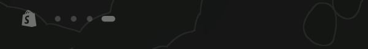
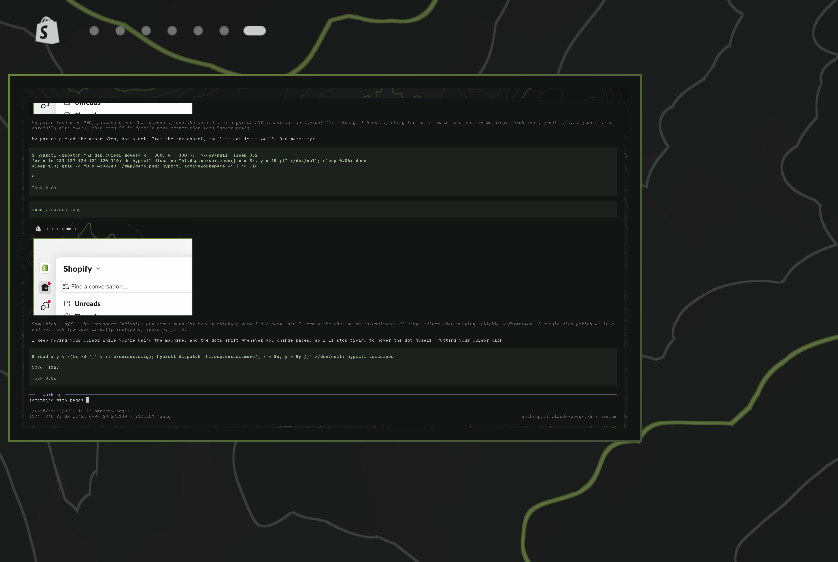
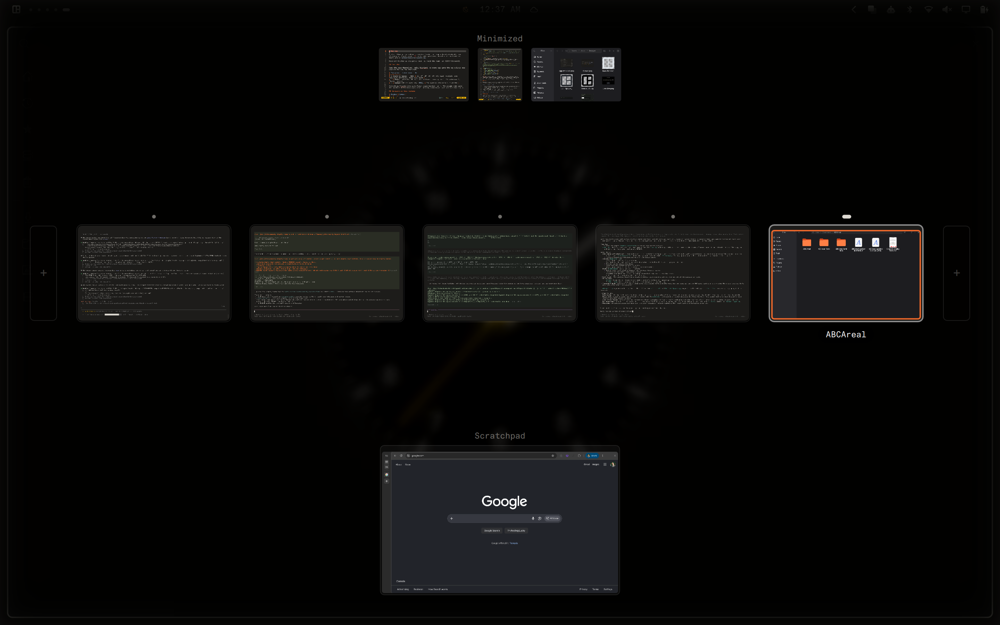
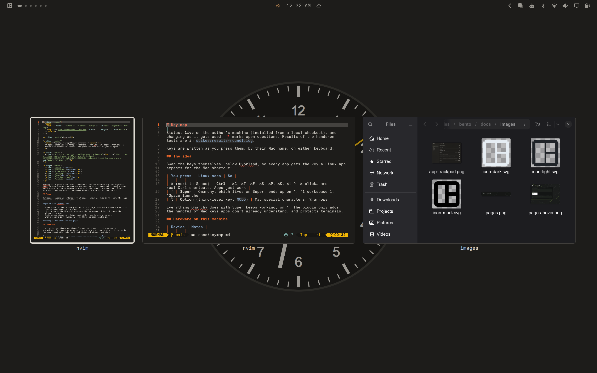
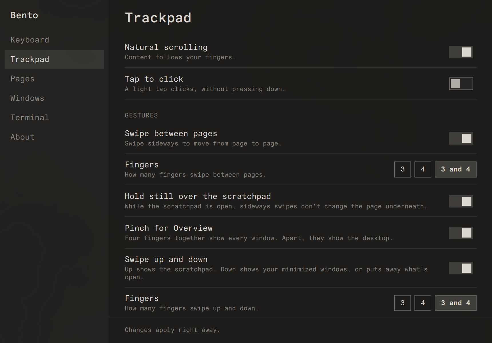

<p align="center">
  <picture>
    <source media="(prefers-color-scheme: dark)" srcset="docs/images/icon-dark.svg">
    
  </picture>
</p>

<h1 align="center">Bento</h1>

<p align="center">
  <strong>Omarchy, thoughtfully arranged.</strong><br>
  An opinionated window manager experience for Omarchy: pages, Overview, a
  drawer for minimized windows, and gestures that follow your fingers.
</p>

<p align="center">
  <a href="https://github.com/tcballard/omarchy-badges"></a>
</p>

<p align="center">
  <a href="#pages">Pages</a> ·
  <a href="#overview">Overview</a> ·
  <a href="#the-drawer">Drawer</a> ·
  <a href="#gestures">Gestures</a> ·
  <a href="#keys">Keys</a> ·
  <a href="#the-bento-app">App</a> ·
  <a href="#install">Install</a>
</p>

Omarchy is a great base: fast, keyboard-first and beautifully put together.
Bento is one opinionated take on how working in it should *feel*. Every window
has a place, you move between places with your hands, nothing you put away
gets lost, and the desktop responds without any delay you can notice.

## Pages

Workspaces become an ordered row of pages, shown as dots in the bar. The page
you're on is a wider, brighter pill. Each monitor has its own row of pages.



- Hover a dot to see a live preview of that page, and slide along the dots to
  flip through them. Click a dot to go there.
- ⌃1 … ⌃0 go to the Nth dot on this monitor, whatever the workspace id is. ⌃⇧N takes the
  window with you.
- Empty pages disappear. Swipe past either end to get a new one.
- When a page's last window closes, the next page slides in.



## Overview

Pinch with your thumb and three fingers, or press ⌃↑, to zoom out to
everything. Each page shows as a true miniature of your monitor, in dot order.
The scratchpad sits underneath and minimized windows sit above.



Click a window to go to it, or a page to go there. The empty frame at either
end starts a new page. You can also move around with the arrow keys and pick
with ↩. Spread your fingers to zoom back in. With Overview closed, spreading
shows the desktop.

## The drawer

⌘M minimizes. Swipe down, or press ⌃↓, and minimized windows drop in from the
top as live cards. Click a card to bring its window back onto the page you're
on. Flick a card up, middle-click it or press ⌫ to close the window.



## Gestures

| Gesture | Does |
|---|---|
| Two fingers | Scroll. Content follows your fingers |
| Three or four fingers sideways | Move between pages, following your fingers. A flick switches, and a slow drag peeks |
| Three or four fingers up | The scratchpad |
| Three or four fingers down | The drawer |
| Pinch, thumb and three fingers | Overview |
| Spread, thumb and three fingers | Show the desktop |

Gestures finish what your hand began, with short animations you can
interrupt. Each gesture can be switched off, and its finger count changed.

## Keys

The key beside Space talks to apps. ⌘ sends Ctrl at the keyboard layout, so
every app gets its native shortcuts without remapping. The desktop lives on ⌃,
and ⌥ types special characters. On top of that:

- Text editing that works the same everywhere: ⌘←/→ to the ends of the line,
  ⌥←/→ by word, and ⇧ to select.
- A ⌘W that closes the tab first and the window only when no tab is left.
- ⌘Q, ⌘Tab, a launcher on ⌘Space, and screenshots on ⌘⇧3/4/5.
- Terminal keys that stay terminal keys: ⌃C, ⌃D and ⌃R reach the shell.
- Ghostty keys for copy, paste (images included), tabs and splits.

Every key, what it replaced and why is in [`docs/keymap.md`](docs/keymap.md).

## The Bento app

One window, with a pane per area and a row per setting. Run `bento`, press ⌃⌘,
or find **Bento** in the app launcher.



Changes apply as soon as you make them. If Hyprland rejects a change, Bento
puts the previous settings back, so a bad setting can't leave you with a broken
desktop. Only what differs from [`defaults.json`](defaults.json) is saved, in
`~/.config/bento/settings.json`.

## Principles

1. **Direct manipulation.** If your fingers start it, the screen follows them.
2. **Places, not numbers.** You think in "the page to the right", not in
   workspace 1004.
3. **Nothing gets lost.** Minimized, scratchpad or off to the side, everything
   shows up in Overview and is one gesture away.
4. **Native first.** Apps get the keys they expect. Bento only translates where
   it has to, and it leaves terminals alone.
5. **Opinionated, not locked in.** Strong defaults, each with a switch.
   Removing Bento gives you back stock Omarchy.
6. **Never break the desktop.** Every change is checked and rolled back if
   Hyprland complains, and a failing module doesn't take the others down.
7. **Readable.** A few Lua and QML files you can search. Behaviour lives in
   Hyprland, and interface in the Omarchy shell.

## Where it's going

Bento's aim is a desktop that feels designed as a whole, from the first
keypress to the last frame of an animation. These are directions, not promises:

- **Gestures that follow your fingers all the way.** Overview and the drawer
  should follow your fingers continuously, the way page swipes already do.
- **Window arrangement as a first-class idea.** Snap, split and resize with
  gestures and keys that make sense together, and layouts that remember where
  things go.
- **A real app switcher.** App icons, live previews and per-app window
  cycling.
- **Overview as a workbench.** Drag windows between pages, reorder pages, and
  drop a window into the drawer.
- **One feel for motion.** Shared timing and easing across pages, Overview, the
  drawer and the bar.

Ideas and rough edges are welcome as issues.

## Install

Bento needs Omarchy 4 or newer (the release that configures Hyprland in Lua).

```bash
omarchy plugin add https://github.com/benjaminsehl/bento --enable
```

The plugin runs [`install.sh`](install.sh) each time the shell starts. The
first run hooks Bento into Hyprland, and later runs find everything in place
and do nothing. If something stops it, a desktop notification says why.

`install.sh` also works from any checkout of this repo and points everything at
that checkout, so to update you edit the files and run `hyprctl reload`.
Re-run `install.sh` after changing `xkb/`. On Apple keyboards,
`sudo system/apple-fnmode.sh` puts the media keys first on the top row.

<details>
<summary>What the installer touches</summary>

| Path | What it is |
|---|---|
| `~/.local/state/omarchy/toggles/hypr/bento.lua` | One line that loads `hypr/bento.lua` from the checkout |
| `~/.local/state/bento/` | Compiled keymaps, and errors from the last reload |
| `~/.local/bin/bento`, `bento-apply`, `mac-keybindings` | Links into `bin/` |
| `~/.local/share/applications/bento.desktop` | The Bento app, in the launcher |
| `~/.config/bento/settings.json` | Your settings |
| `~/.config/omarchy/shell.json` | Page dots in place of Omarchy's workspace numbers (if on) |
| `~/.config/ghostty/config` | One `config-file` line for Bento's Ghostty keys (if on) |

Nothing is written to `~/.config/hypr` or `/usr/share/omarchy`.

</details>

## Remove

Run the uninstaller first, or the plugin hooks Bento back in the next time the
shell starts:

```bash
~/.config/omarchy/plugins/io.github.benjaminsehl.bento/uninstall.sh
omarchy plugin remove io.github.benjaminsehl.bento
```

This puts Omarchy's own bindings and workspace numbers back. Your settings stay
in `~/.config/bento`.

## Docs

- [`docs/keymap.md`](docs/keymap.md): every key and gesture, and why.
- [`docs/pages.md`](docs/pages.md): pages, Overview and the drawer in detail.
- [`defaults.json`](defaults.json) and [`prefs/Schema.js`](prefs/Schema.js): every setting.
- [`docs/screenshots.sh`](docs/screenshots.sh): retakes the screenshots in this README.

| Part | Lives in |
|---|---|
| Keys, gestures, page logic | `hypr/*.lua`, loaded by `hypr/bento.lua` through an Omarchy toggle |
| Keyboard layout | `xkb/symbols/bento`, compiled by `install.sh` |
| Bar dots and previews | `pages/` (an Omarchy shell bar widget) |
| Overview, the drawer, the Bento app | `overview/`, `drawer/`, `prefs/`, behind one overlay (`Overlay.qml`) |
| Settings and applying them | `defaults.json`, `Settings.qml`, `hypr/settings.lua`, `bin/bento-apply` |

MIT licensed.
