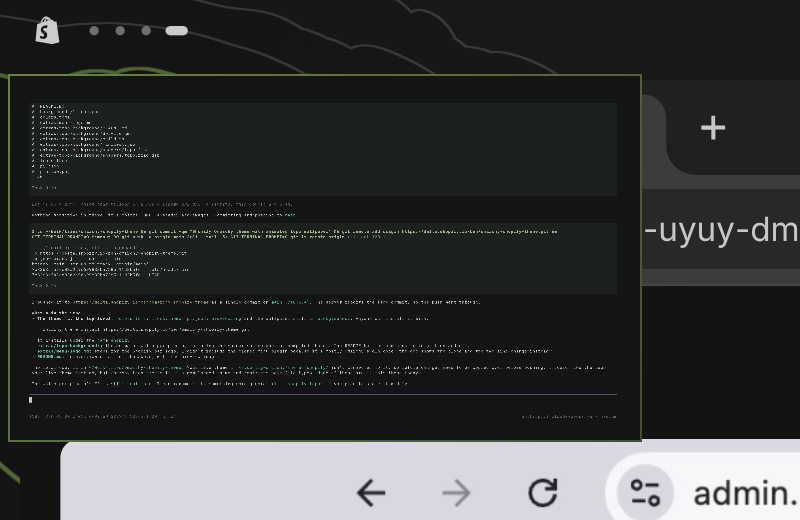

# Pages

An [Omarchy](https://omarchy.org) bar widget that shows workspaces as page dots instead of numbers.




- One dot per page that has windows. The page you're on is a wider, brighter pill.
- Empty pages just disappear. Hyprland removes a workspace once you leave it empty.
- Close the last window on a page and you slide to the next page on the right.
  On the rightmost page you stay on the empty screen.
- `SUPER + N` goes to the Nth dot, so `SUPER + 2` is always the second dot, whatever its workspace number.
  `SUPER + SHIFT + N` moves the window there, and adding `ALT` moves it without following.
  A number past the last dot opens a new page at the end.
- Click a dot to go to that page.
- Hover a dot to see a live preview of that page: your wallpaper plus each window, captured in place.
  Slide along the dots to flip through previews.
- Works in horizontal and vertical bars.

## Exposé

Pinch three fingers together to zoom out to everything. Spread them, press `Esc` or click the background to zoom back in.

- Every page is a miniature of your monitor, in dot order, with its windows exactly where Hyprland put them.
  The page you're on is outlined.
- The scratchpad is a miniature too, centred at the bottom.
- Minimized windows have no place on screen, so they sit in a small shelf centred at the top.
- Click a window to go to it. A minimized window comes back onto the page you're on.
- Click a page to go there, or the scratchpad to open it. The empty frame at either end starts a new page.
- Arrow keys move the selection and `Enter` picks it. Only the selected window shows its title.

libinput only recognises gestures of up to four fingers, so a five-finger pinch can't work.

The overlay is part of this plugin. `install.sh` sets up the gesture, which you can also trigger yourself:

```bash
omarchy-shell shell toggle io.github.benjaminsehl.pages '{}'
```

## Install

```bash
omarchy plugin add https://github.com/benjaminsehl/omarchy-pages.git --enable
```

Then make the number keys follow the dots and turn on the left-edge page. This replaces Omarchy's `SUPER + 1…0` workspace bindings:

```bash
~/.config/omarchy/plugins/io.github.benjaminsehl.pages/install.sh
```

Run `uninstall.sh` from the same folder to restore the default bindings.

To replace the built-in numbers, disable `omarchy.workspaces`. You can also swap the id
`omarchy.workspaces` for `io.github.benjaminsehl.pages` in `~/.config/omarchy/shell.json`.

## New pages

Turn on Hyprland's workspace swipe, for example in `~/.config/hypr/input.lua`:

```lua
hl.gesture({ fingers = 3, direction = "horizontal", action = "workspace" })
```

- **Swipe past the last dot** to get an empty desktop at the end. Hyprland does this itself through
  `gestures:workspace_swipe_create_new`, which is on by default.
- **Swipe past the first dot** to get an empty desktop that becomes dot #1. `install.sh` sets this up.
  Hyprland can't create workspaces off the left end, so `hypr/pages.lua` keeps one empty, persistent
  workspace just left of the first page. The bar hides it until you're on it. Open a window there and
  it becomes a real page, and a new empty one is placed to its left.

Workspace ids can't go below 1, so new sessions start at workspace 1001 to leave room on the left.
If a monitor still runs out of room, its windows move up 1000 ids once. The ids never show anywhere,
since the dots and `SUPER + N` only count positions.

## Tweaks

Edit the top of `BarWidget.qml`:

- `dotSize`: the dot diameter in px
- `slot`: the space each dot takes up in px

In `PagePreview.qml`, `previewWidth` sets the preview's width (260 px by default).

Run `omarchy restart shell` after editing. Hot reload can keep showing the cached version.

## License

MIT
